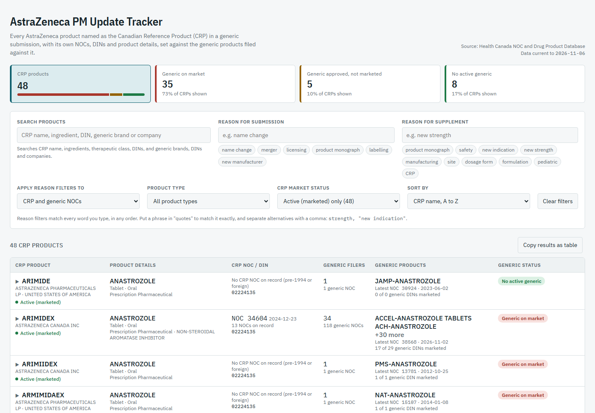

# AstraZeneca PM Update Tracker

A web page that lists every AstraZeneca product named as the Canadian Reference Product (CRP) in a generic drug submission in Canada. For each one it shows the CRP's own Notices of Compliance (NOCs), DINs and product details, and the generic products filed against it, including whether those generics are on the market.

The data is rebuilt from Health Canada's public APIs every night and published with GitHub Pages. The same tracker can also run in Databricks, as a notebook or as a Streamlit app (see [Databricks](#databricks)).

**Live page:** https://mahasrini1.github.io/pm-update-tracker/ · **Built page in this repo:** [`site/index.html`](site/index.html)



## What the page shows

For each AstraZeneca CRP:

- Brand name, company, medicinal ingredients, dosage form, route, product type and therapeutic class
- The CRP's own NOCs (New Drug Submissions and their supplements, including product monograph updates) and DINs
- Market status from the Drug Product Database (DPD). The page shows active (marketed) CRPs by default.
- The generic companies, brands, NOCs and DINs filed against it, and a generic status:

| Status | Meaning |
|---|---|
| Generic on market | At least one generic DIN that names this CRP is currently marketed |
| Generic approved, not marketed | No generic DIN is marketed, but at least one is approved or dormant |
| No active generic | Every generic DIN is cancelled or not in the DPD |

You can filter by words in the **reason for submission** and **reason for supplement**, by product search, by product type and by market status. Select a row to see its full NOC history, with the current DPD status of every DIN.

### Which products are listed

A CRP is listed when a generic submission names AstraZeneca as the CRP company, or when AstraZeneca holds the CRP's own NOCs. Company names are matched by close spelling against `ASTRAZENECA`, `ZENECA` and `ASTRA PHARMA`, which catches typos such as `ASTRZENECA` and predecessors such as Astra Pharma and Zeneca Pharma. To track another company, change `COMPANY` and `COMPANY_NAMES` at the top of `scripts/build.py` (and in `databricks_app/app.py`).

Generic filers often misspell the CRP name, so one product can appear under several spellings (for example `ARIMIDEX` and `ARIMIIDEX`).

## Data sources

All data comes from Health Canada under the [Open Government Licence – Canada](https://open.canada.ca/en/open-government-licence-canada):

- [Notice of Compliance API](https://health-products.canada.ca/api/documentation/noc-documentation-en.html): `noticeofcompliancemain`, `drugproduct`, `medicinalingredient`, `dosageform`, `route`
- [Drug Product Database API](https://health-products.canada.ca/api/documentation/dpd-documentation-en.html): `drugproduct`, `status`

Inactive NOC records (`noc_active_status` other than 1) are excluded.

### Limits

- The NOC database lists approved submissions only. Filings still under review do not appear.
- CRP NOCs are matched by brand name. Products approved before 1994 often have no NOC record, so their details come from the generic NOCs that reference them.
- CRPs are matched to the DPD by DIN, then brand name, then close spelling, because many CRP names in generic filings contain typos. CRPs that match nothing are listed as "Not found in DPD".

## How it is built

```
scripts/fetch_data.py   downloads the API data into raw/
scripts/build.py        joins it into data.json (one record per AstraZeneca CRP)
scripts/assemble.py     embeds data.json into src/template.html -> site/index.html
.github/workflows/publish.yml   runs all three nightly and on every push, then deploys site/ to GitHub Pages
```

To run it on your own computer (Python 3.10 or later, no extra packages):

```bash
python scripts/fetch_data.py raw
python scripts/build.py raw data.json
python scripts/assemble.py src/template.html data.json site/index.html
```

Then open `site/index.html` in a browser.

To refresh the published page without waiting for the nightly run, open the **Actions** tab on GitHub, choose **Refresh data and publish tracker** and select **Run workflow**.

## Databricks

Two single-file versions run the same rules in Databricks:

- **`pm_update_tracker_databricks.py`**: a notebook (import it into a workspace). It downloads the API data into a Unity Catalog volume, builds the tracker, saves the Delta tables `pm_tracker_crps` and `pm_tracker_nocs`, and shows the page. Schedule it as a nightly Job to replace the GitHub workflow.
- **`databricks_app/app.py`**: a Streamlit app for Databricks Apps that reads the 7 Health Canada tables you already load each day, through a SQL warehouse. Set `TABLES` and `WAREHOUSE_ID` at the top of the file, deploy it as a custom app, and give the app's service principal CAN USE on the warehouse and SELECT on the tables. The table columns are expected to use the API's JSON field names.
